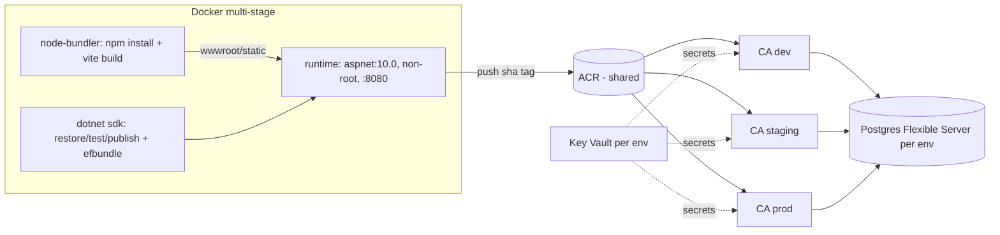
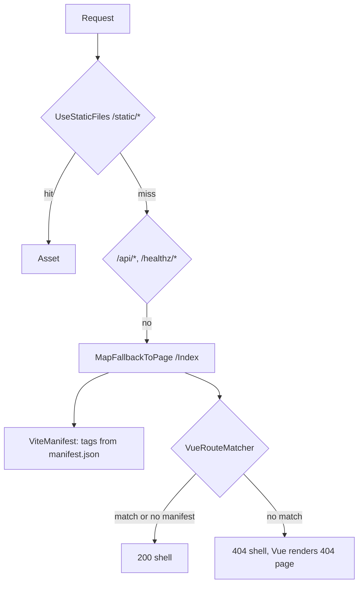

# Implementation Plan: Django → .NET on Azure (Vue + Vite unchanged)

Status: Draft, open questions at the end

## Problem Statement

Replace the thin Django backend in this repo with ASP.NET Core and move hosting and CI/CD to Azure. The repo stays a reusable template that `init.yml` renames. The Vue 3 + Vite frontend and its build pipeline stay as they are: manifest-driven asset injection plus the route manifest.

## Requirements

- **Hosting:** Azure Container Apps, with images in Azure Container Registry (ACR).
- **Serving model:** .NET serves the SPA shell, matching today's Django behavior:
  - Vite assets are injected from the manifest.
  - The JSON context blob is embedded in the page.
  - Unknown routes get a real 404 status, checked against `vue-routes.json`.
- **CI/CD:** code stays on GitHub. GitHub Actions deploys through OIDC federation, so no long-lived Azure secrets.
- **Auth:** none for now.
- **Data:** PostgreSQL everywhere. Local dev uses a Postgres container in compose. Azure uses Azure Database for PostgreSQL Flexible Server, through EF Core with Npgsql.
- **Local dev:** docker-compose runs three services:
  - postgres
  - node running `vite build --watch`
  - .NET running `dotnet watch`

  .NET hot-reloads both manifests.
- **Environments:** dev, staging, and prod, defined in Bicep.
- **Template:** keep the `app_name` / `AppName` placeholders, and extend `init.yml` to rename the .NET and Bicep artifacts.

### Defaults chosen (override if needed)

- .NET 10 LTS
- xUnit with `WebApplicationFactory`, plus Testcontainers for Postgres tests
- Branch mapping: `develop` → dev, `qa` → staging, `main` → prod (prod requires approval)
- Keep Coveralls; Trivy replaces the UW-IT vuln-scan action
- Rename `django-context-data` → `app-context-data` and Pinia store `django-context` → `app-context`
- Drop the unused `csrf_token` and `data-*` body attributes; add antiforgery once APIs exist

### Why GitHub Actions instead of Azure DevOps

GitHub Actions covers OIDC login, the ACR push, Container Apps deploys, Bicep, and environment approvals. Azure DevOps adds value mainly for advanced deploy gates, Key Vault-linked variable groups, Azure Artifacts feeds, Boards and Test Plans, or an org mandate. None of those are required today.

## Background (from the current repo)

- Django has no APIs, models, or auth. Its whole job:
  - `app_name/templatetags/vite.py` walks `.vite/manifest.json` recursively through `imports` (with dedupe), collects `file` and `css`, and emits `<link rel="stylesheet">` and `<script type="module">` tags prefixed with `/static/`.
  - `app_name/views/pages.py` and `app_name/utils/vue_routes.py` serve the catch-all shell. They return a 404 status when the path doesn't match `vue-routes.json` (`:param` → `[^/]+`, anchored, trailing slash normalized), fail open when the file is missing, and cache by mtime.
  - `app_name/templates/index.html` embeds `{debugMode, googleAnalyticsKey, clarityProjectId}` through `json_script` with id `django-context-data`, which `app_name_vue/stores/context.js` reads.
- Vite builds with `base: "/static/"`, `outDir: app_name/static/`, unhashed CSS filenames, and `vite-plugin-vue-route-manifest.js`, which writes `app_name/vue-routes.json`.
- Settings, the static file server, and the WSGI server all come from UW-IT base images (`django-container:3.1.1`, GCP Artifact Registry) that aren't in the repo. CI uses the `uw-it-aca/actions/*` shared actions. All of that gets replaced.
- `init.yml` only renames lowercase `app_name` directories and patches `*.py` for `AppName`. It needs to handle PascalCase paths and C#/Bicep files.
- **Publish gotcha:** the .NET SDK skips dot-folders like `.vite/`, both from default content globs and from `dotnet publish`. The Dockerfile should copy the Vite output into the runtime image directly rather than rely on publish.
- `solstice-theme` and `solstice-vue` install from GitHub. If those repos are private, CI needs a token. Not verified yet.

## Proposed Solution





### Target repo layout

```
app_name_vue/                 (unchanged, apart from store id)
src/AppName.Web/              ASP.NET Core (Razor Pages for the shell, minimal APIs for /api)
  Pages/Index.cshtml          SPA shell
  Vite/ViteManifest.cs, ViteTagHelper.cs, VueRouteMatcher.cs
  Data/AppDbContext.cs, Migrations/
  wwwroot/static/             Vite output (gitignored)
tests/AppName.Web.Tests/      xUnit
infra/                        Bicep: main.bicep, modules/, env/{dev,staging,prod}.bicepparam, bootstrap.sh
AppName.slnx, Dockerfile, docker-compose.yml
.github/workflows/{ci-cd.yml,infra.yml,init.yml}
```

### Key design points

- **Vite stays mostly the same.** Only `outDir` changes, to `src/AppName.Web/wwwroot/static`, along with the route manifest's output path. `base: "/static/"` keeps working because `wwwroot/static` is served at `/static/`.
- **Manifest caching.** `ViteManifest` and `VueRouteMatcher` are singletons that cache by file mtime, which ports the Django logic as-is. Both paths can be set in config.
- **Context blob.** Serialized with System.Text.Json using camelCase; the default encoder escapes `<`, `>` and `&`, so it's HTML-safe. Values come from the same env vars (`GOOGLE_ANALYTICS_KEY`, `CLARITY_PROJECT_ID`). `debugMode` is set from `IsDevelopment()`.
- **Migrations.** `dotnet ef migrations bundle` ships in the image. In dev, migrations apply on startup. In Azure, they run as a Container Apps Job before each revision update, so the runner never needs a network path to the database.
- **Health checks.** `/healthz/live` checks the process only. `/healthz/ready` also checks Postgres. These back the Container Apps probes.
- **Images.** One shared ACR, and each image is built once and promoted through dev → staging → prod by its commit SHA.

## Task Breakdown

### Task 1: Scaffold the .NET solution and point Vite at it

- **Objective:** create `AppName.slnx`, `src/AppName.Web` (net10.0), and `tests/AppName.Web.Tests` (xUnit, `Microsoft.AspNetCore.Mvc.Testing`). Pin the package versions.
- **Guidance:**
  - Add `/healthz/live`, and serve `UseStaticFiles` from wwwroot.
  - Change Vite's `outDir` to `src/AppName.Web/wwwroot/static` and the route manifest output to `.../wwwroot/static/app_name/vue-routes.json`.
  - Update `.gitignore`.
  - Leave Django in place so the old flow still works.
- **Tests:** `/healthz/live` returns 200. A static file placed in a test wwwroot is served at `/static/...`.
- **Demo:** `npm run build && dotnet run --project src/AppName.Web`. `/healthz/live` returns 200, and `/static/app_name/assets/main.css` loads.

### Task 2: Vite manifest service and SPA shell

- **Objective:** port `templatetags/vite.py` and `index.html` to .NET.
- **Guidance:**
  - Write a `ViteManifest` service that walks entries recursively through `imports` with dedupe, collects `file` and `css`, prefixes `/static/`, and caches by mtime.
  - Add a `<vite-styles entry>` / `<vite-scripts entry>` tag helper.
  - `Pages/Index.cshtml` reproduces the head: favicon, Google Fonts, the context JSON `<script id="app-context-data" type="application/json">`, `body.bg-body`, and `#app`.
  - Add an `AppOptions` options class bound from the env vars.
  - Update `stores/context.js` with the new element and store ids, and fix the matching vitest specs.
- **Tests:**
  - Unit tests for manifest parsing, ported from `test_templatetags.py`: nested imports, dedupe, css collection, and a missing entry giving a clear error.
  - Integration test: `/` returns 200, the HTML contains the expected tags, and the context JSON has the three keys and escapes `</script>`.
  - `npm run test` passes.
- **Demo:** after `npm run build`, `dotnet run` renders the full Vue app at `/`, the same as under Django.

### Task 3: Route validation and the fallback with real 404s

- **Objective:** port `vue_routes.py` and the catch-all view.
- **Guidance:**
  - `VueRouteMatcher` converts `:param` to `[^/]+` with `^$` anchors, normalizes slashes, caches by mtime, and fails open when the manifest is missing.
  - Wire up `MapFallbackToPage("/Index")`; the page model sets 404 when nothing matches.
  - Add a dev-only `/500` test page.
  - Order the pipeline: static files, then `/api` and `/healthz`, then the fallback.
- **Tests:**
  - `/customize` returns 200, `/nope` returns 404 with the shell body, and `/` returns 200.
  - When the manifest is missing, any path returns 200.
  - Unit tests cover `:id` patterns and trailing slashes.
- **Demo:** browsing to `/does-not-exist` returns status 404 in devtools, and Vue renders the styled 404 page.

### Task 4: PostgreSQL with EF Core

- **Objective:** add `AppDbContext` (Npgsql), an initial migration, and the `/healthz/ready` DB health check.
- **Guidance:**
  - The connection string comes from `ConnectionStrings__Default`.
  - Apply migrations automatically on startup in Development only.
  - Add an `efbundle` build target.
  - Optional: a sample entity and `GET /api/v1/...` endpoint (open question 2).
- **Tests:** Testcontainers.PostgreSql integration tests. Migrations apply cleanly, `/healthz/ready` returns 200 with the DB up, and returns 503 when the DB is unreachable.
- **Demo:** run `dotnet run` against a local Postgres. `/healthz/ready` returns Healthy, and the `__EFMigrationsHistory` table exists.

### Task 5: Dockerfile and docker-compose for local dev

- **Objective:** replace the UW-IT images with a fully public multi-stage build.
- **Guidance:**
  - Dockerfile stages:
    - `node-bundler` (node:24): `npm install` and `vite build`
    - `build` (dotnet/sdk:10.0): restore, publish, efbundle
    - `test`
    - `dev` (sdk, `dotnet watch`, `DOTNET_USE_POLLING_FILE_WATCHER=1`)
    - `runtime` (dotnet/aspnet:10.0, non-root `APP_UID`, port 8080): copies the publish output plus `wwwroot/static` from node-bundler, which preserves `.vite/`
  - docker-compose services:
    - `postgres:17` with a named volume
    - `node-bundler` running `npm run watch`, writing into the mounted `wwwroot/static`
    - `app` (dev target) mounting `src/`, with ports `${RUNSERVER_PORT:-8000}:8080`
  - Update `.env.sample` with the Postgres variables.
- **Tests:** `docker build --target test` runs the xUnit suite. Lighthouse (`npm run lighthouse`) works against compose.
- **Demo:** run `docker compose up --build`. Add a new `.vue` page, refresh, and the new route returns 200 with no restart.

### Task 6: Remove the Django and Python artifacts

- **Objective:** delete everything the .NET side has now replaced.
- **Guidance:**
  - Remove `app_name/` (Python, templates, templatetags, tests), `docker/` (settings, urls, `app_start.sh`, `test.sh`), `setup.py`, `requirements*.txt`, `pyproject.toml`, `MANIFEST.in`, `.coveragerc`, and `.ruff_cache`.
  - Update `.dockerignore`, `.vscode`, `.zed`, and `README_sample.md`.
- **Tests:** the full .NET and vitest suites pass, and the compose stack runs.
- **Demo:** a clean clone runs end to end with no Python installed.

### Task 7: GitHub Actions CI

- **Objective:** replace `cicd.yml` with `ci-cd.yml`, starting with the build and test jobs.
- **Guidance:**
  - On PRs and pushes to develop, qa, and main:
    - `dotnet format --verify-no-changes`
    - `npm run oxlint` and `oxfmt:check` (new; not run in CI today)
    - `dotnet test` with Coverlet producing Cobertura output, and vitest coverage
    - Upload both to Coveralls with parallel finish
    - Build the runtime image with buildx and the GHA cache
    - Trivy scan for HIGH and CRITICAL
  - If the solstice repos turn out to be private, add a GitHub token for npm.
- **Tests:** the pipeline itself is the test.
- **Demo:** opening a PR shows green checks and coverage on Coveralls.

### Task 8: Bicep infrastructure and the OIDC bootstrap

- **Objective:** define Azure resources as code.
- **Guidance:**
  - Shared resource group: ACR and Log Analytics.
  - Per-environment resource group:
    - Container Apps environment
    - Container App with a user-assigned managed identity, AcrPull, Key Vault secret references, and probes
    - Migration Container Apps Job
    - Postgres Flexible Server and its database
    - Key Vault
  - Parameter files for dev, staging, and prod with SKUs sized per environment.
  - `infra/bootstrap.sh`, run once by a human: creates the deployer identity and its federated credentials for the GitHub environments, plus the role assignments.
  - An `infra.yml` workflow runs `az deployment ... what-if` on PRs that touch `infra/` and deploys on merge.
- **Tests:** `az bicep build` and lint in CI, and the what-if output reviewed on the PR.
- **Demo:** the dev environment is provisioned, with the Container App running a placeholder image.

### Task 9: Deploy stages

- **Objective:** extend `ci-cd.yml` to push and promote images.
- **Guidance:**
  - Use `azure/login` with OIDC per GitHub environment, and push `acr/app_name:<sha>`.
  - Per environment, start the migration job with the new image and wait for it to succeed, then run `az containerapp update --image`.
  - Branch mapping: `develop` → dev, `qa` → staging, `main` → prod. The prod environment requires a reviewer.
  - After each deploy, smoke-test `/healthz/ready` and one 404 route.
- **Tests:** the smoke-test step, and a failed migration blocks the rollout.
- **Demo:** pushing to `develop` deploys to the dev URL, and merging to `main` waits for approval, then deploys to prod.

### Task 10: Template initialization and docs

- **Objective:** make `init.yml` handle the new stack.
- **Guidance:**
  - Rename paths containing `AppName` (directories and files such as `.csproj` and `.slnx`), in addition to `app_name`.
  - Run sed across `*.cs`, `*.cshtml`, `*.csproj`, `*.slnx`, `*.bicep`, `*.bicepparam`, and the workflows.
  - Drop the Python-specific step.
  - Add a dry-run job that runs init in a temp checkout, then builds and tests, so the template can't break silently.
  - Rewrite `README_sample.md`: prerequisites, compose, `bootstrap.sh`, and environments.
- **Tests:** the dry-run job renames to `cool_app`, then `dotnet build`, `dotnet test`, and `npm run build` all pass.
- **Demo:** "Use this template" with `APP_NAME=cool_app` gives a repo that builds and deploys under the new name.

## Open Questions

1. **How should the app authenticate to Postgres in Azure?**
   - a. Managed identity (Entra auth, no password). The most secure option. Npgsql gets tokens through Azure.Identity. A bit more setup in Bicep and bootstrap.
   - b. Password in Key Vault. Simpler. The Container App reads it as a secret reference. Still needs a rotation story.
2. **Networking and a sample API?**
   - a. Public endpoints + Postgres firewall (allow Azure services), no sample API. The cheapest and simplest.
   - b. VNet: Container Apps environment in a subnet, private Postgres. Better posture, with higher cost and complexity.
   - c. Either of the above plus a sample `/api/v1/...` endpoint and entity that shows the EF Core and Vue fetch pattern in the template.
3. **Azure conventions?**
   - a. Use the defaults: region, a naming convention like `rg-app_name-dev`, and a single subscription.
   - b. Align with your org's subscription layout, naming and tagging policy, region, or Azure Policy constraints (e.g., required private endpoints).
